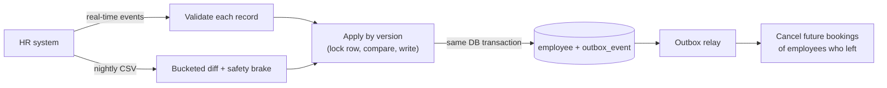

# HR Roster Sync

**MoveInSync Backend Case Study 2026 · Case Study 5 — HR Roster Sync: Idempotent, Out-of-Order, Self-Healing**

Java 21 · Spring Boot 3.4 · PostgreSQL 16 · Docker Compose

> 🎥 **Demo video:** _add your link here_
> 📐 **Design note** (architecture, sequence diagram, failure-mode table): [docs/DESIGN.md](docs/DESIGN.md)

---

## 1. The problem in one paragraph

Corporate clients keep their employee list in an HR system and send changes to MoveInSync — new
joiners, transfers, shift changes, exits — through an API in near real time, plus a **full nightly
file of up to 200,000 employees**. In real life that data is messy: the same update arrives **twice**,
updates arrive **out of order**, some records are **invalid**, and sometimes the nightly file is **cut
off halfway**. If we trusted it blindly, a half-file would deactivate thousands of employees and
cancel their cabs. This service keeps the employee records correct anyway.

## 2. How it works — the four ideas



| # | Idea | In plain words |
|---|---|---|
| 1 | **Versions decide everything** | Every change carries a version number per employee. Newer version → applied. Older → ignored (`STALE`). Same version again → nothing happens (`DUPLICATE`). So duplicates and out-of-order delivery are harmless. |
| 2 | **Each field has one owner** | HR owns name, email, phone, manager, office, shift. The transport admin owns pickup point and special assistance. An HR update physically cannot touch the transport fields. |
| 3 | **Nightly diff in 64 buckets, behind a safety brake** | The file is split into 64 small pieces on disk and compared piece by piece, so memory stays small. If ≥30% of active employees are suddenly missing, the run **stops, deactivates nobody, and waits for an operator**. |
| 4 | **Transactional outbox** | The employee change and its "something changed" event are saved in **one** database transaction — they can never disagree, even if the server crashes. A background relay delivers the events; consumers ignore duplicates. |

## 3. Run it

**Option A — one command (needs Docker Desktop):**

```bash
docker compose up --build
```

First build takes ~5 minutes (downloads dependencies); later starts take seconds.
When you see `Started RosterSyncApplication`, open <http://localhost:8080/actuator/health> → `{"status":"UP"}`.

To start again from an empty database: `docker compose down -v` then `docker compose up`.

**Option B — without Docker (needs only Java 21):**

```bash
./mvnw spring-boot:test-run -Dspring-boot.run.main-class=com.moveinsync.rostersync.LocalDevApplication
```

This starts the app with a built-in temporary PostgreSQL (data is lost when it stops).

## 4. See it work (demo scripts)

With the app running, open a second terminal (on Windows use **Git Bash**):

```bash
bash scripts/demo.sh          # the main flows, step by step
bash scripts/crash-demo.sh    # kills the app mid-flight and shows it recover (needs Option A)
```

What `demo.sh` shows:

| Step | What happens | What to look for |
|---|---|---|
| 1 | HR sends 3 joiners, one with a bad phone number | `"applied": 2, "rejected": 1` — one bad record does not fail the batch |
| 2 | Version 7 arrives **before** version 6 | v6 → `STALE`; employee stays on v7 (office BLR-02, shift EVENING) |
| 3 | Version 7 is sent again | `DUPLICATE` — nothing changes |
| 4 | Transport admin sets a pickup point, then HR sends an update that includes one | pickup point unchanged, warning `FIELD_NOT_OWNED` |
| 5 | Another client's admin asks for our employee | `HTTP 404` — tenants are isolated |
| 6 | Employee with a future cab booking is deactivated | booking becomes `CANCELLED` |
| 7 | Nightly file with 1,001 employees | `COMPLETED`, 1,000 new |
| 8 | Nightly file cut off at 600 rows | `AWAITING_APPROVAL` — "401 of 1001 (40.1%) missing", **nobody deactivated** |
| 9 | Operator rejects the broken run | `REJECTED`, data untouched |
| 10 | On-call view | outbox lag, queue depth, counters |

What `crash-demo.sh` shows: an employee is deactivated, and the server is **killed** (like `kill -9`)
right after saving the change but **before** the event is delivered. Docker restarts it, the relay
finds the undelivered event in the outbox table, and the booking still gets cancelled — exactly once.

### Demo logins (HTTP Basic)

| User | Password | Role | Client |
|---|---|---|---|
| `acme-hr` | `acme-hr-pass` | HR system — sends events and nightly files | acme |
| `acme-transport` | `acme-transport-pass` | Transport admin — pickup points, bookings | acme |
| `acme-ops` | `acme-ops-pass` | Operator — approves braked runs, sees metrics | acme |
| `acme-e1001` | `acme-e1001-pass` | Employee E1001 — can only read own record | acme |
| `globex-hr`, `globex-transport`, `globex-ops` | `<username>-pass` | same roles | globex |

Offices that exist: acme `BLR-01`, `BLR-02`, `HYD-01`; globex `PUN-01`, `GGN-01`.

## 5. Every hard rule has a test

```bash
./mvnw test                 # 64 tests, ~2 minutes, uses a real (embedded) PostgreSQL — no Docker needed
./mvnw -Pbenchmark test     # performance benchmarks (JVM limited to 384 MB on purpose)
```

| Rule from the case study | Test that proves it |
|---|---|
| Stale update ignored, duplicate is a no-op | `EmployeeMergerTest`, `outOfOrderUpdateIsIgnoredAsStale` |
| Replaying the same feed twice changes nothing | `replayingTheSameFeedTwiceChangesNothing`, `reRunningTheSameExportChangesNothing` |
| One bad record never fails a batch | `oneBadRecordNeverFailsTheBatch`, `invalidRowsAreReportedAndNeverDeactivateAnyone` |
| HR never overwrites transport-owned fields | `hrUpdateNeverOverwritesTransportOwnedFields` |
| Concurrent, out-of-order delivery converges correctly | `concurrentOutOfOrderDeliveryConvergesToHighestVersion` (8 threads, 400 deliveries) |
| Broken nightly file → brake, nobody deactivated | `truncatedExportTripsTheSafetyBrakeAndDeactivatesNobody`, `operatorApprovalAppliesTheBrakedRun` |
| Crash between DB write and event publish | `OutboxCrashTest` (3 different crash points) |
| Leavers' bookings cancelled, exactly once | `crashAfterPublishBeforeMarkRedeliversAndConsumerDedups` |
| No personal data in logs or errors | `personalDataNeverAppearsInLogs`, `errorsAreStructuredAndNeverEchoTheInput` |
| One client can never read another's data | `anotherTenantCannotReadOrEditOurEmployee`, `anotherTenantCannotSeeOurReconciliationRuns` |
| 200,000-row diff in < 60 s with bounded memory | `SnapshotDiffBenchmarkTest` |

## 6. Performance

Measured on a 2-vCPU Intel Xeon @ 2.10 GHz cloud machine with 7 GB RAM, Java 21, PostgreSQL 14 on the
**same** 2 vCPUs (so the numbers are conservative), JVM capped at 384 MB.

| Scenario | Result |
|---|---|
| **Nightly diff: 200,000 stored vs 199,000-row file** (2,000 changed, 1,000 new, 2,000 left) | **2.2 s** end to end — target was < 60 s |
| Peak memory during that diff | **≤ 93 MB** |
| Broken file (120,000 of 199,000 rows) | brake tripped in **1.4 s**, 79,000 missing reported, nobody deactivated |
| Real-time updates, 8 concurrent writers | **≈ 4,500 events/s**, latency **p50 1.3 ms, p99 7.6 ms** |
| First-ever load of 200,000 new employees | 63 s (≈ 3,150 rows/s, limited by database writes) |

## 7. Key decisions and trade-offs

- **Correctness over availability for writes.** Every change locks the employee row and commits together
  with its event. If the database is down, the API fails fast instead of accepting data it could lose;
  HR retries, and versions make retries safe.
- **Delivery is at-least-once, the effect is exactly-once.** After a crash an event may be delivered twice;
  the consumer records each event id and ignores repeats. True exactly-once delivery across crashes
  is not possible.
- **A broken nightly file is not trusted at all.** When the brake trips, even valid new joiners in that file
  wait for the operator.
- **Only office codes are cached** (5-minute expiry), because every validation reads them. Employee data
  is never cached — correctness depends on reading the locked row.
- **Deliberately left out:** Kafka (events go through one interface, `ChangeEventPublisher`, that a Kafka
  version would implement), OAuth2/JWT (HTTP Basic + BCrypt behind TLS instead), and partial "delta"
  updates from HR.

Full details — failure-mode table, complexity, where it stops scaling, metrics — in [docs/DESIGN.md](docs/DESIGN.md).

## 8. Assumptions

1. HR sends the **full** HR record with each create/update, with a version number per employee that only
   goes up. (This is what makes "highest version wins" correct.)
2. **Idempotency key = (client, employeeId, version).** Same version + same data = duplicate. Same version +
   different data = `CONFLICT`, reported and not applied.
3. The nightly file lists **active** employees. An active employee missing from it has left — unless the
   brake trips.
4. A reconciliation deactivates someone only if their version hasn't changed since the file was compared,
   so a newer real-time update always wins.
5. Transport-owned fields: last write wins among transport admins.
6. Times are stored in UTC.

## 9. API reference

All errors look the same and never echo the input:
`{"status":404, "code":"NOT_FOUND", "detail":"employee not found", "requestId":"…"}`

| Method & path | Who | What |
|---|---|---|
| `POST /api/v1/hr/events` | HR | Up to 1,000 `CREATE` / `UPDATE` / `DEACTIVATE` events; always returns a per-record report |
| `POST /api/v1/hr/snapshots` (form field `file`) | HR | Upload the nightly CSV; returns the run report |
| `GET /api/v1/reconciliations/{id}` · `/errors` · `/missing` | Operator, HR | Run status, per-row errors, sample of missing ids |
| `POST /api/v1/reconciliations/{id}/approve` · `/reject` | Operator | Decide a braked run |
| `GET /api/v1/employees/{id}` · `/{id}/events` | Transport admin, Operator | Employee record · events emitted for them |
| `PUT /api/v1/employees/{id}/transport` | Transport admin | Set pickup point / special assistance |
| `GET /api/v1/me` | Employee | Own record only |
| `POST /api/v1/bookings` · `GET /api/v1/bookings?employeeId=` | Transport admin | Cab bookings |
| `GET` / `POST /api/v1/offices` | Transport admin, Operator | Office codes |
| `GET /api/v1/ops/outbox` · `/outbox/dead` · `POST /outbox/dead/replay` | Operator | Event queue health, failed events, retry them |
| `GET /actuator/health` · `/actuator/prometheus` | anyone · Operator | Health · metrics |

Example — send one event:

```bash
curl -u acme-hr:acme-hr-pass -H 'Content-Type: application/json' http://localhost:8080/api/v1/hr/events -d '{"events":[
  {"type":"CREATE","employeeId":"E1001","version":1,"name":"Priya Sharma","email":"priya@acme.com",
   "phone":"+919800000001","managerId":"M1","officeCode":"BLR-01","shiftCode":"MORNING"}]}'
```

Nightly file format (the last `#TRAILER` line is optional; if present and the row count doesn't match, the brake trips):

```csv
employeeId,version,name,email,phone,managerId,officeCode,shiftCode
E1001,8,Priya Sharma,priya@acme.com,+919800000001,M2,BLR-02,EVENING
#TRAILER,1
```

## 10. Code map

```
src/main/java/com/moveinsync/rostersync/
├── domain/          the rules, plain Java (no Spring, no DB) — start reading here
│   ├── EmployeeMerger.java      version + ownership rules (stale / duplicate / conflict / apply)
│   ├── SafetyBrake.java         when a nightly file looks broken
│   └── validation/              per-record validation
├── sync/            real-time API → EmployeeSyncService (lock rows, merge, write, outbox) 
├── reconciliation/  nightly file: split into buckets → compare → brake → apply
├── outbox/          OutboxRelay: deliver events, retry with backoff, dead-letter
├── booking/         cancel future bookings when an employee leaves
├── employee/        database access, transport-owned fields, office cache
├── security/        logins, roles, tenant isolation
└── common/, ops/    error format, request ids, crash injection for the demo
```
