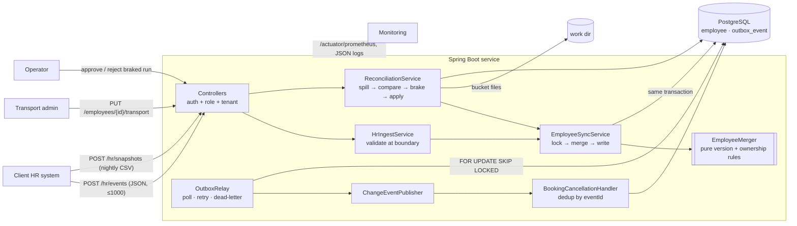
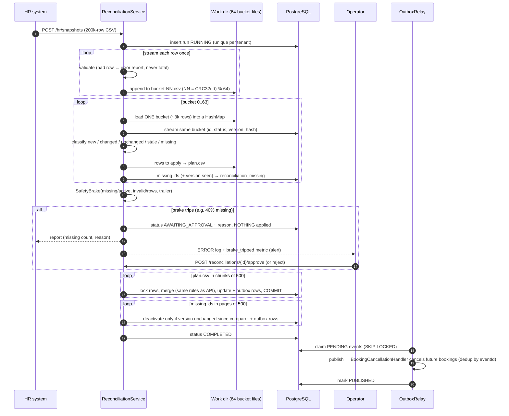

# Design note — HR Roster Sync

## 1. Architecture

**Layers.** Controllers (HTTP, auth) → services (transactions, orchestration) → repositories (SQL).
The rules live in `domain/` as plain classes with no Spring or database, so they are unit-tested
directly: `EmployeeMerger` (ordering/idempotency/ownership), `SafetyBrake`, `RecordValidator`,
`BucketComparator`.

**Data model.** `employee` (PK `tenant_id, employee_id`; HR columns + transport columns + `hr_version`,
`hr_hash`, `bucket`), `outbox_event`, `processed_event` (consumer dedup), `booking`,
`reconciliation_run` / `_missing` / `_error`. Every table starts with `tenant_id`.

## 2. The rules

**Idempotency key** = `(tenant, employeeId, version)`. **Version comparison** per employee:

| incoming vs stored | result |
|---|---|
| `v < stored` | **STALE** — ignored |
| `v == stored`, same data (SHA-256 of normalised HR fields) | **DUPLICATE** — no-op |
| `v == stored`, different data | **CONFLICT** — reported, not applied |
| `v > stored`, data changed | **APPLIED** — new state + one outbox event |
| `v > stored`, same data | **VERSION_ONLY** — version moves forward, no event |

Edge cases handled: a DEACTIVATE for an unknown employee stores a *tombstone* (so a late, older
CREATE cannot resurrect them); re-sending an old version never reactivates someone the
reconciliation deactivated; an employee who reappears in a later export is reactivated.

**Field ownership.** HR owns name, email, phone, manager, office, shift. The transport admin owns
pickup point and special assistance. Enforced structurally: `HrRecord` has no transport fields, the HR
`UPDATE` statement does not mention transport columns, and transport edits go through
`TransportService` only. Transport fields sent by HR are ignored with a `FIELD_NOT_OWNED` warning.
Within transport admins: last write wins.

**Concurrency.** Each batch runs in one transaction: `SELECT … FOR UPDATE` on the affected employees
(sorted by id to avoid deadlocks), merge in Java, write, append outbox rows, commit. The row lock
serialises every writer of one employee (API threads, reconciliation, other app instances). A brand
new employee is inserted with `ON CONFLICT DO NOTHING`; if another transaction won the race, the batch
rolls back and retries, and this time the row exists and is locked.

## 3. Hardest flow — nightly reconciliation with the safety brake

Why it is correct: nothing touches `employee` until the brake has passed; every applied row goes
through the same version rule as the API (so re-running a file is a no-op and a stale export row
never beats a newer API update); deactivation re-checks the version captured at compare time; an
invalid row counts as "present" so a bad phone number never deactivates anyone.

## 4. Consistency model and the outbox

The employee row and its change event are written **in the same database transaction** — they commit
together or not at all. A separate relay publishes outbox rows oldest-first and marks them published.
Delivery is **at-least-once** (a crash after publishing and before marking re-publishes); consumers make
the **effect exactly-once** by recording `(consumer, eventId)` in `processed_event` in the same
transaction as their side effect. Events are per-employee ordered: the relay stops a batch at the first
failure so a later event is not published before an earlier one (until the earlier one is dead-lettered).
Event payloads carry IDs, version, office/shift codes and changed field *names* — no personal data.

## 5. Failure modes

| What fails | What the user sees | How the system recovers |
|---|---|---|
| Process crashes inside the sync transaction | HR gets a 5xx/timeout for that batch | Transaction rolled back (row + outbox together). HR retries; versions make the retry idempotent. `crashInsideTheSyncTransaction…` |
| Process crashes after commit, before publish | Change is visible; downstream effect delayed | Event is still `PENDING`; relay publishes it after restart. Live: `scripts/crash-demo.sh` (JVM halt, exit 137). |
| Crash after publish, before marking published | Nothing visible | Event re-published; consumer dedups by `eventId`. `crashAfterPublishBeforeMark…` |
| Downstream consumer failing | Bookings not yet cancelled; `outbox_lag_seconds` grows | Retry with exponential backoff + jitter; after 8 attempts → `DEAD`, alert, operator replays via `/ops/outbox/dead/replay`. |
| Nightly file cut off / missing ≥30% / ≥10% invalid / trailer mismatch | Run `AWAITING_APPROVAL` with reason and missing count; nobody deactivated | Operator approves or rejects; a newer export supersedes it. |
| Bad records (malformed phone, unknown office, short row) | Per-record error report (row, employeeId, field, code) | Valid records applied; invalid ones skipped and **not** treated as missing. |
| Duplicate / out-of-order events | `DUPLICATE` / `STALE` in the report | Version rule; no state change, no event. |
| Two writers on one employee (API + nightly, or two nodes) | Nothing | Row lock serialises them; version rule decides; insert race → retry. |
| Crash during reconciliation | Run shows `FAILED` after restart | Startup marks interrupted runs `FAILED`; re-upload is safe (idempotent). |
| PostgreSQL down | 5xx with `requestId`; health DOWN | Ingest fails fast (no data accepted that could be lost); HR retries later. |
| Another reconciliation already running for the tenant | 409 `RUN_IN_PROGRESS` | Unique partial index; retry later. |

## 6. Cost — time and space

Let *N* = rows in the export, *S* = stored employees for the tenant, *B* = 64 buckets, *k* = batch size.

- **Real-time apply:** O(k log k) per batch (sort) + one indexed lock query + batched writes. Memory O(k).
- **Spill:** O(N) time, O(B) open file buffers. **Compare:** O(N + S) time; memory O((N + S)/B) — one
  bucket at a time, not the whole file (measured ≤93 MB peak for 200k with `-Xmx384m`).
  Invalid-row ids are kept in memory, bounded by the invalid-ratio brake (≤10% of N).
- **Apply:** O(changed + missing) row writes in chunks of 500. Disk: O(N) temporary files, deleted after the run.

**Where it stops scaling.** (1) PostgreSQL write throughput: a first-ever load of a large tenant is
insert-bound (~3k rows/s on the 2-vCPU benchmark box); fix with bigger hardware, `COPY` for
initial loads, or partitioning `employee` by tenant. (2) The relay is a single ordered stream; at very high
event rates partition it by `hash(employeeId)` so ordering stays per employee. (3) A synchronous upload
for files far beyond 200k rows; move to a background job (same phases, already resumable by re-run).
(4) Hot single employee: changes to one employee are serialised by design.

## 7. Caching

Only one thing is cached: **the set of office codes per tenant** (read on every validation; 200,000
times per nightly file). Caffeine, `expireAfterWrite = 5 min`, max 10,000 tenants, evicted immediately on
the node that adds an office. **What can be stale:** a newly added office may be rejected as
`UNKNOWN_OFFICE` by *other* app nodes for at most 5 minutes; those records are reported (not lost) and
succeed on HR's retry. Offices are never deleted, so the cache can never accept an invalid code.
Employee data is deliberately **not** cached: correctness depends on reading the locked row.

## 8. Monitoring (what on-call looks at, 3 AM)

`/actuator/prometheus` (operator only) and JSON logs with `requestId`, `runId`, tenant and employee IDs:

| Metric | Meaning |
|---|---|
| `rostersync_changes_total{source,outcome}` | applied / stale / duplicate / conflict / rejected / failed rates |
| `rostersync_validation_rejected_total{code}` | which validation rule is rejecting (e.g. a broken HR field) |
| `rostersync_outbox_pending`, `rostersync_outbox_lag_seconds` | queue depth and age of the oldest unpublished event |
| `rostersync_outbox_publish_failures_total`, `_dead_lettered_total`, `rostersync_outbox_dead` | retries and dead letters |
| `rostersync_reconciliation_brake_tripped_total`, `rostersync_reconciliation_duration` | broken exports, run time |
| `rostersync_apply_latency` (histogram), `http_server_requests` | p50/p99 latency |
| `rostersync_apply_race_retries_total`, `rostersync_consumer_duplicates_total` | contention and redeliveries |

## 9. Security

HTTP Basic (BCrypt) over TLS, stateless. Roles: `HR_SYSTEM`, `TRANSPORT_ADMIN`, `OPERATOR`, `EMPLOYEE`.
The tenant comes from the credential, never from the request; every query filters by it, and another
tenant's resource returns **404** (not 403) so its existence is not leaked. Employees can read only
`/me`. Personal data never goes to logs, error responses, error reports or event payloads (`HrRecord`
and `TransportFields` redact themselves in `toString`; tested by capturing log output).

## 10. Deliberately left out

Kafka (the publisher is an interface; the outbox is the real guarantee), OAuth2/OIDC, a UI,
multi-region, partial-update (delta) events from HR, per-tenant brake thresholds (global config today),
and resuming a half-applied reconciliation (re-running is idempotent instead).
